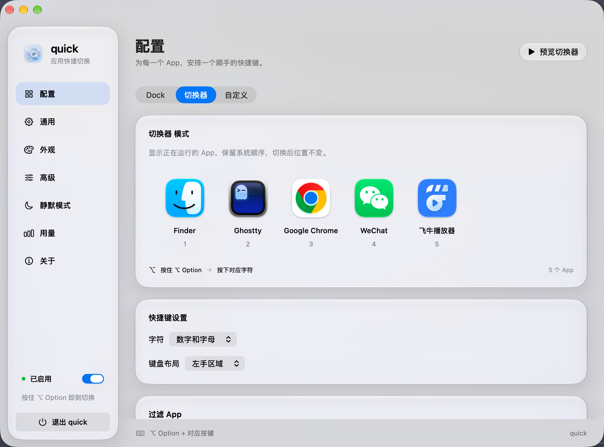

# quick

[简体中文](README.md) | English

quick is a native macOS app switcher built with Swift, SwiftUI, and AppKit, featuring the system's Liquid Glass material. Hold the activation key, then press the character assigned to an app to launch or switch to it—spend less time looking through windows and the Dock.



## Features

- **Three app list modes**: Dock mode follows the apps in your Dock and can place Finder first. Switcher mode shows running apps and lets you exclude selected apps. Custom mode lets you add, remove, reorder, and assign shortcuts to apps.
- **Fast keyboard switching**: Use `⌥ Option` by default, or choose Command, Control, or Shift. Supports numbers, letters, and left- or right-hand keyboard areas. Keep holding the activation key to switch between multiple apps.
- **Custom profiles**: Save, load, and delete app lists, import and export JSON profiles, or load apps from the Dock or currently running apps.
- **Appearance controls**: Preview Liquid Glass, adjust background transparency, size, and screen position, and show the switcher on the screen with the pointer.
- **Switching behavior**: Adjust the display delay and auto-hide timeout, double-press the activation key to pause or enable quick, and hide the frontmost app when selecting it again.
- **Silent apps**: Hide the switcher in selected apps and optionally disable switching shortcuts there as well.
- **Interface languages**: Choose Simplified Chinese or English in **General → Language**. The interface and menus update immediately, and your choice is saved.
- **Menu bar and launch at login**: Access quick from the menu bar. Launch at login uses macOS login item management and requires system acceptance of the registration.
- **Local usage statistics**: Track total switches and switches per app.

## Requirements and installation

- Apple Silicon Mac (arm64).
- macOS 27 or later. The current release package requires macOS 27.0 or later.

Download `quick-X.Y.Z-macos-arm64.dmg` from this repository's **Releases** page. Open it, drag `quick.app` into `Applications`, and launch it from there.

Current builds use ad-hoc signing and do not have an Apple Developer ID signature or Apple notarization. Gatekeeper may restrict the first launch. Once you have confirmed that you trust the source, follow the system prompts in **System Settings → Privacy & Security** to allow the app to open.

Each release also includes a `.sha256` file. Place it in the same directory as the DMG and verify the download:

```bash
shasum -a 256 -c quick-0.0.2-macos-arm64.dmg.sha256
```

## Getting started

1. Launch quick. To use English, select **通用 → 语言 → English**, then choose Dock, Switcher, or Custom mode in **Configuration**.
2. Hold `⌥ Option`, wait for the overlay, and press the character shown below the target app to switch to it.
3. Allow quick in **System Settings → Privacy & Security → Accessibility** to enable full global key interception, direct shortcuts without waiting for the overlay, and window focus restoration. Permission status updates automatically.
4. Adjust the appearance, activation key, silent app list, and custom profiles to suit your workflow.

Without Accessibility permission, you can still hold the activation key to show the overlay and then use registered system hotkeys to select an app. A display delay of `2.5` disables automatic overlay display; an auto-hide timeout of `0` disables automatic hiding.

## Building locally

Xcode 27.2 is recommended, including its macOS SDK and Swift toolchain. The Swift package manifest requires Swift tools 6.2 or later. There are no third-party package dependencies.

Run from the project root:

```bash
bash build.sh
open quick.app
```

To create a versioned DMG:

```bash
bash scripts/package-dmg.sh 0.0.2
```

The `dist/` directory contains the arm64 DMG and its SHA-256 checksum file. The DMG includes the app and a shortcut to Applications. The app bundle version comes from the version argument.

## Automated releases with GitHub Actions

The workflow is in [`.github/workflows/release.yml`](.github/workflows/release.yml). After publishing this directory as the root of a GitHub repository, push a tag in `vX.Y.Z` format to trigger a release, for example:

```bash
git tag v0.0.2
git push origin v0.0.2
```

Commit and push the code and workflow before creating the tag. Creating a tag locally does not trigger Actions. Prerelease tags such as `v0.0.2-beta` are currently unsupported.

The workflow uses GitHub's [`xcode-27` Apple Silicon runner](https://github.com/actions/runner-images/blob/main/images/macos/xcode-27-arm64-Readme.md) with Xcode 27.2 to:

1. Validate the tag format and run the existing mechanics regression checks.
2. Build the Release app, write the tag version into its bundle, and apply a fresh ad-hoc signature.
3. Create and verify the DMG, then generate its SHA-256 checksum file.
4. Save the Actions build artifacts, create a GitHub Release, and upload the installation package and checksum file.

No additional secrets are required; publishing uses GitHub's automatically provided `GITHUB_TOKEN`. Enable Actions for the repository and allow the workflow to use `contents: write`. The runner is currently in preview; consult GitHub's documentation for its availability. Rerunning the workflow for the same tag replaces the corresponding release assets.

## Development and validation

Run the mechanics checks without UI interaction:

```bash
swiftc Sources/Mechanics.swift checks/mechanics-check.swift -o /tmp/quick-mechanics-check
/tmp/quick-mechanics-check
```

Check language switching and compatibility with existing settings:

```bash
python3 checks/run-localization-check.py
```

Run keyboard regression checks in a local desktop session:

```bash
python3 checks/run-keyboard-e2e.py fallback tap packaged
```

The keyboard checks open two temporary input windows and verify consecutive switching, repeated keys, key-release order, and restoration of normal typing. Testing full global key interception requires Accessibility permission. The packaged app test temporarily uses separate settings and restores the original settings afterward, so it is not run in the release CI workflow.

`python3 main.py` is the Craft Anything launch adapter; it only builds and launches the Swift app. `python3 main.py --screenshot shots/now.png` saves a screenshot after approximately 120 frames and exits without explicitly activating the window.
