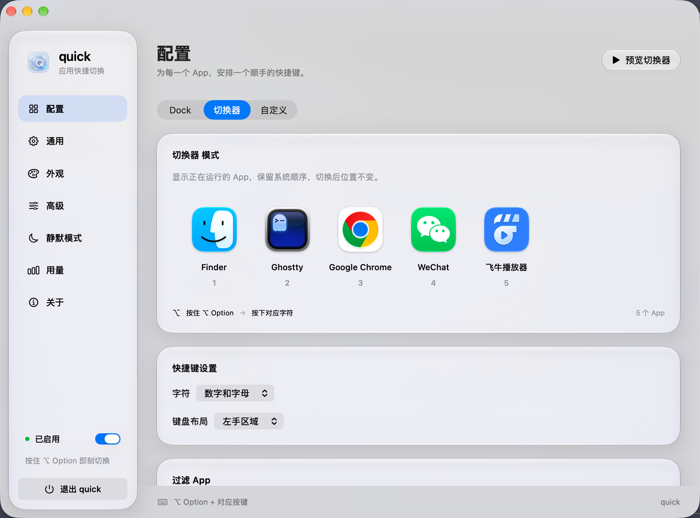

# quick

简体中文 | [English](README.en.md)

quick 是一款原生 macOS 应用切换工具，使用 Swift、SwiftUI 和 AppKit 构建，搭配系统 Liquid Glass 材质。按住激活键，再按应用对应的字符，即可打开或切换应用，减少在窗口和 Dock 之间寻找目标的操作。



## 功能

- **三种应用列表**：Dock 模式跟随 Dock 中的应用，可将访达置顶；切换器模式显示正在运行的应用，并支持排除指定应用；自定义模式支持添加、移除、拖动排序和指定快捷键。
- **键盘快速切换**：默认使用 `⌥ Option`，也可选择 Command、Control 或 Shift。支持数字、字母及左右手键盘区域；按住激活键时可连续切换应用。
- **多套自定义配置**：保存、载入和删除应用列表，支持 JSON 导入导出，也可从 Dock 或运行中的应用载入列表。
- **外观设置**：实时预览 Liquid Glass 效果，调整背景透明度、大小和屏幕位置，并可在光标所在屏幕显示。
- **切换行为设置**：调整显示延迟和自动隐藏时间，支持双击激活键暂停或启用，以及再次选择前台应用时隐藏该应用。
- **静默名单**：在指定应用中隐藏切换浮层，并可同时停用切换快捷键。
- **界面语言**：在“通用 → 语言”中选择简体中文或 English，界面和菜单即时更新，并记住选择。
- **自动更新**：使用 Sparkle 定期检查新版本，按提示下载、安装并重新启动；也可从应用菜单或菜单栏选择“检查更新…”。
- **菜单栏与登录启动**：通过菜单栏访问应用；登录启动由 macOS 管理，需系统接受注册。
- **本地使用统计**：记录总切换次数及各应用的切换次数。

## 系统要求与安装

- Apple Silicon Mac（arm64）。
- macOS 27 或更新版本；当前发布包的最低系统版本为 27.0。

在本仓库的 **Releases** 页面下载 `quick-X.Y.Z-macos-arm64.dmg`，打开后将 `quick.app` 拖入 `Applications`，再从“应用程序”启动。

当前构建采用临时签名（ad-hoc），未配置 Apple Developer ID 签名或 Apple 公证。首次打开时可能受到 Gatekeeper 限制；确认来源可信后，可在“系统设置 → 隐私与安全性”中按系统提示允许打开。

发布页同时提供 `.sha256` 文件，将其与 DMG 放在同一目录后可校验下载内容：

```bash
shasum -a 256 -c quick-0.0.2-macos-arm64.dmg.sha256
```

## 快速上手

1. 启动 quick，在“配置”中选择 Dock、切换器或自定义模式。
2. 按住 `⌥ Option`，等待浮层出现，再按目标应用下方的字符切换应用。
3. 在“系统设置 → 隐私与安全性 → 辅助功能”中授权 quick，以启用完整的全局按键拦截、无需等待浮层的快捷直达及窗口焦点恢复。权限状态会自动更新。
4. 按需要设置外观、激活键、静默名单及自定义配置。

未授权辅助功能时，仍可长按激活键显示浮层，再使用系统快捷键选择应用。显示延迟设为 `2.5` 表示不自动显示浮层；自动隐藏设为 `0` 表示不自动隐藏。

## 本地构建

推荐使用 Xcode 27.2，包含 macOS SDK 和 Swift 工具链。Swift Package 清单要求 Swift tools 6.2 或更新版本，通过 Swift Package Manager 获取固定版本的 Sparkle 更新框架。

在项目根目录执行：

```bash
bash build.sh
open quick.app
```

生成带版本号的 DMG：

```bash
bash scripts/package-dmg.sh 0.0.2
```

产物位于 `dist/`，包含 arm64 DMG 和 SHA-256 校验文件。DMG 内包含应用及指向“应用程序”的快捷方式，应用包版本号取自传入的版本。

## GitHub Actions 自动发布

工作流位于 [`.github/workflows/release.yml`](.github/workflows/release.yml)。将本目录作为 GitHub 仓库根目录上传后，推送 `vX.Y.Z` 格式的标签即可自动发布，例如：

```bash
git tag v0.0.2
git push origin v0.0.2
```

请先提交并推送代码及工作流，再创建标签。仅在本地创建标签不会触发 Actions；`v0.0.2-beta` 等预发布标签目前不支持。

工作流使用 GitHub 的 [`xcode-27` Apple Silicon runner](https://github.com/actions/runner-images/blob/main/images/macos/xcode-27-arm64-Readme.md)，选择 Xcode 27.2，依次完成：

1. 校验标签格式，运行现有机制回归检查。
2. 构建 Release 应用，将标签版本写入应用包并重新临时签名。
3. 创建、验证 DMG，生成 SHA-256 校验文件。
4. 使用 Sparkle Ed25519 私钥签名 DMG，生成 `appcast.xml` 更新清单。
5. 保存 Actions 构建产物，创建 GitHub Release 并上传安装包、校验文件与更新清单。

发布使用 GitHub 自动提供的 `GITHUB_TOKEN`，并需要配置下述 `SPARKLE_PRIVATE_KEY` Secret。仓库需启用 Actions，并允许工作流使用 `contents: write` 权限。该 runner 当前属于预览环境，后续可用性以 GitHub 文档为准。相同标签重新运行时会覆盖对应 Release 附件。

## 自动更新配置

更新源为 `https://github.com/imkratos/quick/releases/latest/download/appcast.xml`，公钥与地址位于 `Resources/Updater.plist`。Sparkle 在第二次启动时询问是否允许自动检查；启用后默认每 24 小时检查一次。发现新版后由用户确认安装，支持跳过版本或稍后提醒。安装包下载后会验证 Ed25519 签名。

首次发布带自动更新的版本前，需要一次性配置签名密钥：

1. 执行 `swift package resolve`，工具位于 `.build/artifacts/sparkle/Sparkle/bin/`。本机密钥已保存在登录钥匙串中，账户名为 `quick`。仅在全新配置时用 `generate_keys --account quick` 创建密钥。**本项目已配置公钥时，必须使用匹配的原始私钥，不要重新生成或替换公钥。**
2. 用 `generate_keys --account quick -x /安全目录/quick-sparkle-private-key` 导出私钥。私钥不得提交到 Git。
3. 在 GitHub 仓库 **Settings → Secrets and variables → Actions** 添加名为 `SPARKLE_PRIVATE_KEY` 的 Secret，值为导出文件的完整内容。完成后妥善保管私钥备份，并删除临时导出文件。
4. 提交代码，推送一个高于现有版本的 `vX.Y.Z` 标签。工作流会同时发布 DMG 和 `appcast.xml`；缺少私钥或签名失败时停止发布。

本地生成更新清单：

```bash
bash scripts/package-dmg.sh 0.0.6
SPARKLE_PRIVATE_KEY_FILE=/安全目录/quick-sparkle-private-key bash scripts/generate-appcast.sh 0.0.6
```

更新公钥已经随应用分发后必须保持稳定；临时签名的应用不能依靠 Developer ID 恢复丢失的更新私钥。更换仓库时需同步修改 `Resources/Updater.plist` 与 `scripts/generate-appcast.sh` 中的仓库地址。

旧版 quick 尚未包含更新器，需要手动安装一次包含此机制的新版本。更新源在首次发布 `appcast.xml` 后生效；此前手动检查会显示获取失败。请从“应用程序”启动，DMG 内的只读应用无法原地更新。

## 开发与验证

运行不需要界面交互的机制检查：

```bash
swiftc Sources/Mechanics.swift checks/mechanics-check.swift -o /tmp/quick-mechanics-check
/tmp/quick-mechanics-check
```

运行语言切换与旧配置兼容检查：

```bash
python3 checks/run-localization-check.py
```

在本地桌面会话中执行键盘回归：

```bash
python3 checks/run-keyboard-e2e.py fallback tap packaged
```

该检查会打开两个临时输入窗口，验证连续切换、重复按键、松键顺序与普通输入恢复；完整全局拦截测试需要辅助功能权限。正式应用测试会临时使用独立配置，结束后恢复原配置，因此不在发布 CI 中运行。

`python3 main.py` 是 Craft Anything 的启动适配入口，只负责构建与启动 Swift 程序。`python3 main.py --screenshot shots/now.png` 可在约 120 帧后保存截图并退出，不主动激活窗口。
